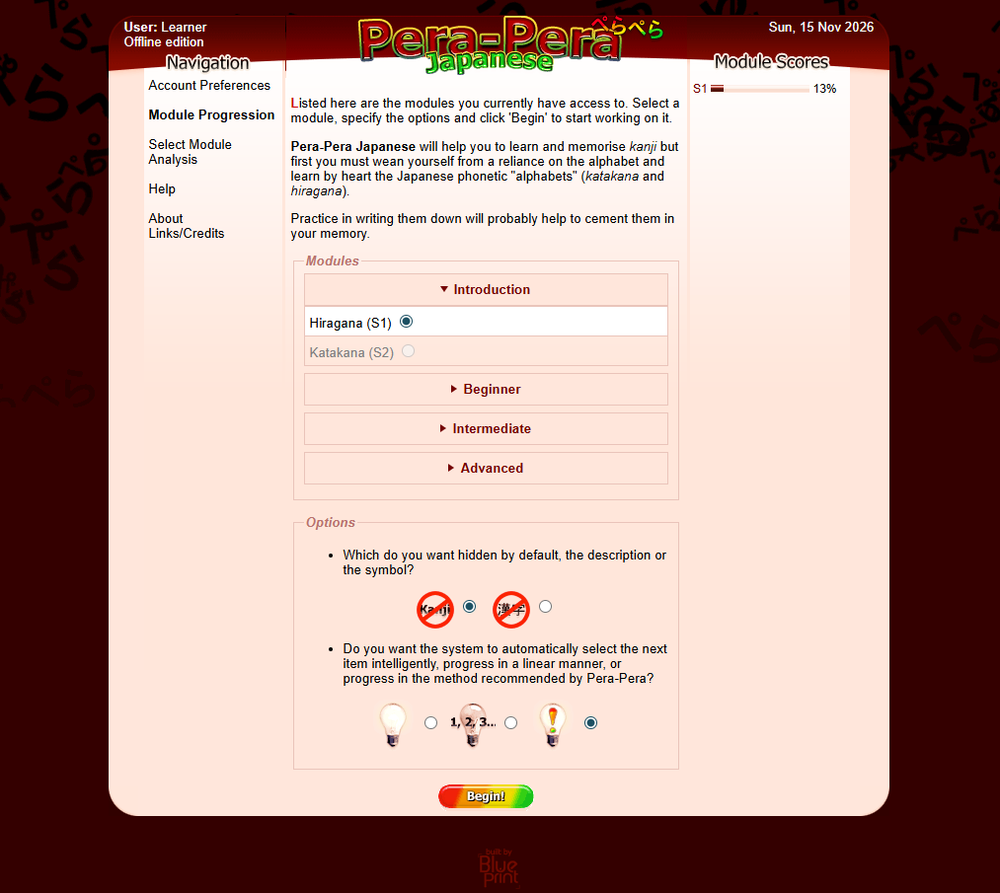
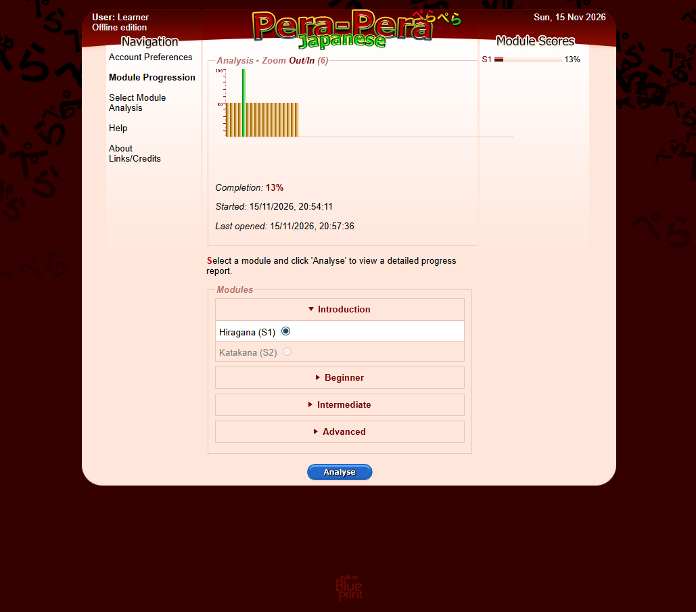
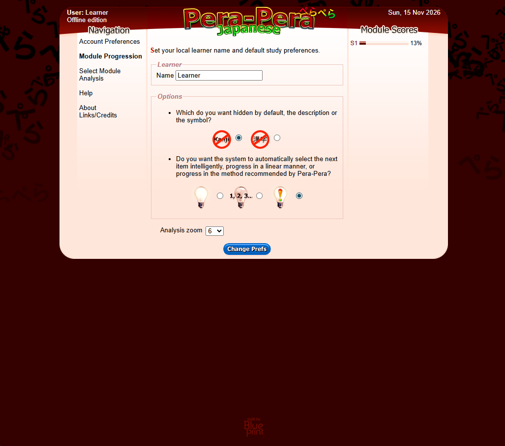

# Pera-Pera Japanese

**A Japanese learning application originally developed in 2006, restored for Windows in 2026.**

Pera-Pera (ぺらぺら) is an offline study system for learning hiragana, katakana, kanji and Japanese vocabulary. Originally developed in collaboration with a researcher from the University of Tokyo, it combines mnemonic techniques, active recall, adaptive repetition and structured progression to help learners develop lasting familiarity with written Japanese.

The standalone edition preserves the original visual identity and learning methodology, without requiring an online account, a subscription or an internet connection.

  

<em>Choose a module, configure your study session and begin learning.</em>

**[Download the latest release](https://github.com/fistmaster2k4/perapera/releases)** · **[Freeware licence](LICENSE.md)**

## Features

- **24 structured modules** containing 66 study sections and **7,381 learning items**.
- Hiragana and katakana, followed by beginner, intermediate and advanced kanji and vocabulary.
- Mnemonic-based character learning, meanings and readings where provided.
- Active recall in either direction: hide the symbol or the description, then reveal the answer.
- Intelligent, Linear and Recommended progression modes.
- Individual item mastery scores and visual module analysis.
- Automatic progression: complete the current section to unlock the next.
- Previously unlocked sections remain available for revision.
- Local learner preferences and saved progress.
- No accounts, subscriptions, advertising, in-app purchases or paid module unlocks.

## How the learning system works

Pera-Pera was designed around the problem of turning short-term familiarity into long-term recall. Rather than simply presenting a fixed sequence of flashcards, it records how confidently a learner recalls each item and uses that information to guide subsequent practice.

### 1. Recognise, recall and reveal

Begin with a character or its description, depending on your preferred study direction. Try to recall the hidden information before revealing it. Where supplied, mnemonic descriptions help associate a character's shape or components with its meaning; pronunciation and vocabulary provide additional context.

The learner then rates the difficulty of their own recall. This is a self-assessment system, not an automated examination or a measure of conversational fluency.

### 2. Build mastery through repetition

Each item has a mastery score from 0 to 100. The original scoring system rewards successful recall and keeps difficult material in circulation.

| Rating | Points added | Meaning |
| --- | ---: | --- |
| Easy | +50 | Confident recall |
| Medium | +20 | Recalled with some effort |
| Hard | +5 | Difficult recall |
| Pass | +0 | Move on without increasing mastery |

Only **Easy** can bring an item to 100% mastery. Medium and Hard ratings cannot take an item beyond 99%, ensuring that complete mastery requires a confident recall rating. Once an item reaches 100%, its score is retained.

For example, an unfamiliar character rated Hard, then Medium, then Easy has a score of 75. A further Easy rating completes it.

### 3. Choose how the next item is selected

| Mode | Behaviour |
| --- | --- |
| Intelligent | Weighted random selection, favouring unfamiliar and less-mastered items. |
| Linear | Work through the selected section in order. |
| Recommended | Initially follows the curriculum in order, then probabilistically skips better-known items while moving forward. |

In Intelligent mode, a previously scored item is assigned a selection weight of `101 - mastery score`. An unseen item receives a weight of 100.

A character scored at 20 therefore has a weight of 81, whereas one scored at 90 has a weight of 11. The less familiar item is more likely to appear again, without preventing revision of familiar material entirely.

When all items are mastered, Intelligent mode selects them uniformly for revision.

Recommended mode combines forward progression with the same familiarity weighting. Once progress exists, each candidate is probabilistically accepted or skipped, so the learner spends less time on items they already know.

This is **mastery-weighted adaptive repetition**, rather than a calendar-based spaced-repetition system. Selection is driven by recorded recall confidence, not a scheduled interval in days.

### 4. Progress at your own pace

A section's completion percentage is the average of its individual item scores, rounded down. To unlock the next section, every item in the current section must reach 100.

All content is included in the standalone edition. Progression is a learning mechanism, not a payment or subscription restriction.

Use **Analysis** to review individual scores, completion percentage, start date and last-opened date. The graph can be zoomed for larger sections, and the recent-module score panel provides quick access to previously studied material.

  

<em>Individual mastery scores expose weak areas that an overall completion percentage can hide.</em>

## Curriculum

| Level | Main modules | Coverage |
| --- | ---: | --- |
| Introduction | 2 | Hiragana and katakana |
| Beginner | 3 | Beginning kanji and associated vocabulary |
| Intermediate | 7 | Intermediate kanji and associated vocabulary |
| Advanced | 12 | Advanced kanji and associated vocabulary |
| **Total** | **24** | **66 character and vocabulary sections** |

The preserved curriculum contains **2,272 character entries** and **5,109 vocabulary entries**. It follows the original educational ordering rather than a newly designed modern proficiency-test syllabus.

The phonetic alphabets come first, allowing learners to become familiar with written Japanese before progressing to kanji. Character and vocabulary sections are studied in the original sequence. The collapsible Introduction, Beginner, Intermediate and Advanced groups keep the complete curriculum manageable.

## Preferences and original interface

The standalone restoration retains the original three-column interface, graphics and visual style. The navigation, study controls and module score panel work without a web server or external account.

| About Pera-Pera | Learner preferences |
| --- | --- |
|  |  |

The learner can set their local display name, choose whether to hide the symbol or description, select a default progression mode and adjust the analysis zoom. These preferences and study progress are stored locally.

## Installation

### Requirements

- Windows 10 or Windows 11, 64-bit.
- [.NET 8 Desktop Runtime (x64)](https://dotnet.microsoft.com/en-us/download/dotnet/8.0).
- [Microsoft Edge WebView2 Runtime](https://developer.microsoft.com/en-us/microsoft-edge/webview2/).

### Running Pera-Pera

1. Open the [Releases page](https://github.com/fistmaster2k4/perapera/releases) and download `PeraPera-1.1.0.zip` or the latest available release.
2. Extract the entire archive to a folder of your choice.
3. Install the required Microsoft runtimes if they are not already present.
4. Launch `PeraPera.exe`.
5. Select **Hiragana** and begin your first study session.

No installer, web hosting or database server is required. Keep the extracted files and subfolders together. Once the required runtimes are installed, the application can be used offline.

The current distribution is a Windows x64, framework-dependent desktop application. The standalone version is packaged as a Release build without development dependencies or application PDB files.

## Project history

Pera-Pera began in 2006 as an online Japanese learning system developed by Blueprinted in collaboration with a University of Tokyo researcher. The researcher supplied the educational concept and material; Blueprinted developed the application, learning engine, graphics and interface.

The 2026 restoration brings that original experience back as a Windows desktop application, twenty years after its initial creation. Its web-based interface and original learning behaviour are preserved, with local SQLite-backed progress storage replacing the original online account system.

The standalone edition removes the original commercial module-access restrictions. Every module is included, with access determined by the learner's progress.

## Credits and educational sources

  

- Original educational concept, content and module design: the original researcher.
- Original application and graphics: **Blueprinted**.
- Standalone restoration: **fistmaster2k4**.
- Jim Breen's **EDICT** dictionary.
- The **Kumon** kanji teaching order.
- Vocabulary compiled by Thierry Bézecourt (© 2001), with English translations by Norbert Burger.
- The original Japanese proficiency test lists.
- Original inspiration: *Remembering the Kanji* by James W. Heisig.

The original source acknowledgements have been preserved. The educational curriculum was restored for archival purposes, and permission for redistribution of the original curriculum remains to be confirmed. Third-party material retains its applicable rights and licence terms; the freeware licence does not override them.

## Licence

Pera-Pera Japanese is **proprietary freeware**, free for personal and educational use. Official, unmodified application distributions may be shared free of charge under the terms of the [Pera-Pera Freeware Licence](LICENSE.md).

The application is not open source. Commercial resale, unauthorised redistribution of modified versions and redistribution of the proprietary source code are not permitted.

Copyright © 2006–2026 **fistmaster2k4**. All rights reserved.

---

*Originally created in 2006. Restored in 2026.*
